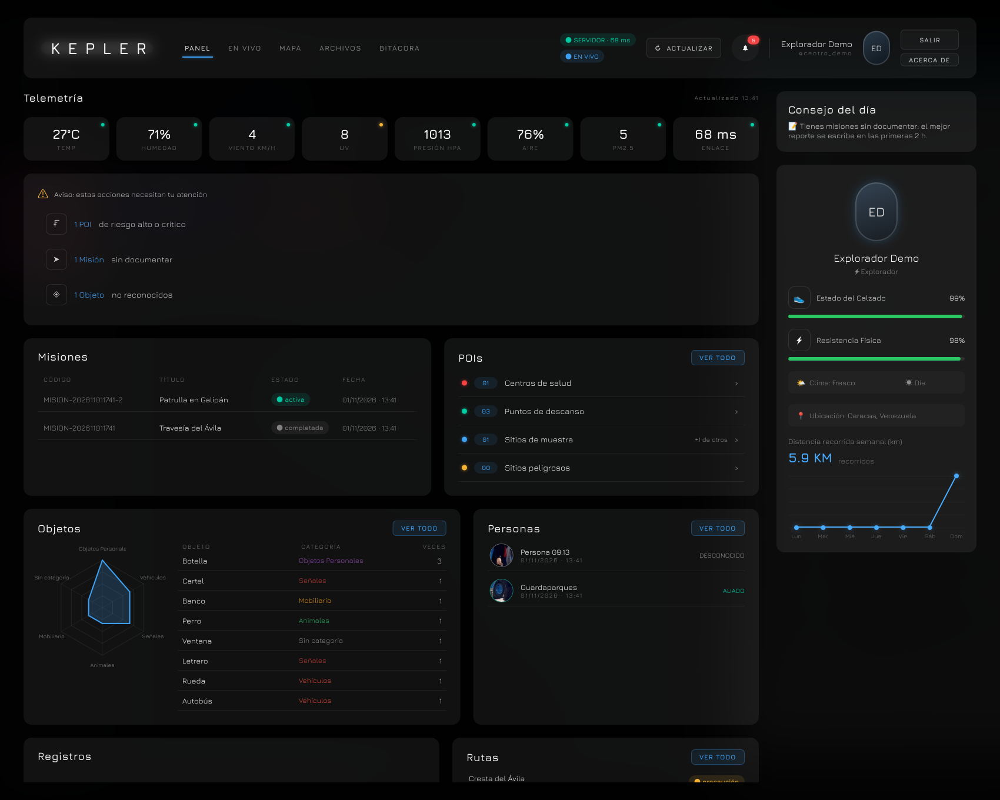
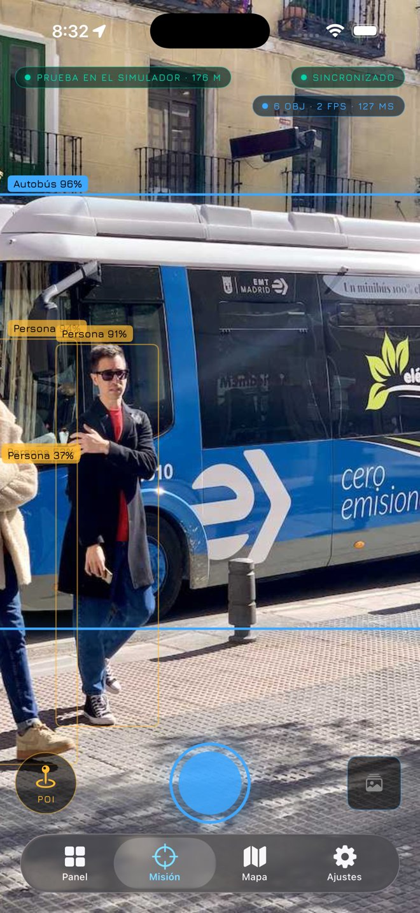
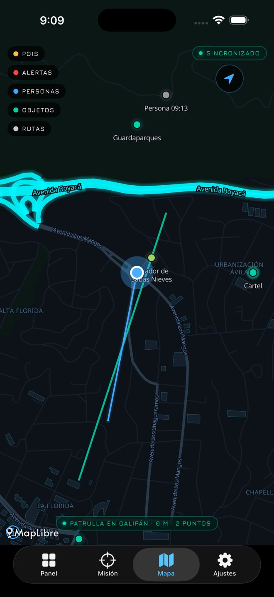
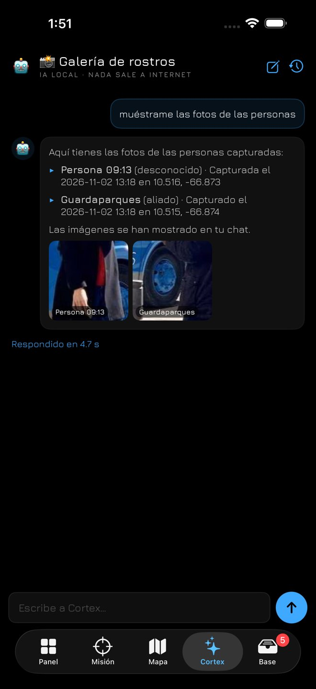
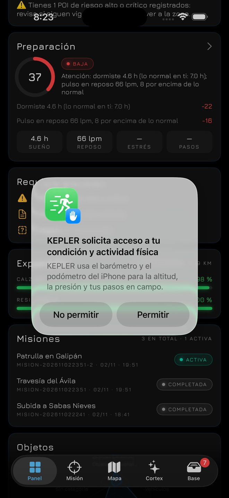

<div align="center">

# 🔭 K E P L E R

### Plataforma de exploración de campo asistida por IA

**v0.8 — reescrita en Rust**

</div>

---

KEPLER une visión artificial (YOLO + CLIP), geolocalización, telemetría del explorador y un copiloto LLM local (**Cortex**) en un solo flujo de trabajo para exploración de campo. La Unidad de Campo funciona sin conexión en terreno y sincroniza al volver a la base; el Centro de Control sigue la misión en vivo desde el escritorio.

<div align="center">

</div>

## 🧭 Componentes

| Componente | Tecnología | Rol |
|---|---|---|
| **Unidad de Campo** | SwiftUI + núcleo Rust (UniFFI) | iPhone: cámara con YOLO26 en CoreML (60 fps), capturas con Re-ID, misiones y rastro GPS sin conexión, mapa offline, Cortex, salud y reloj |
| **Centro de Control** | Rust + Slint + MapLibre Native | Escritorio: dashboard, vista en vivo, mapa, archivos, bitácora, Cortex |
| **kepler-server** | Rust (axum, sqlx) | API REST + WebSocket protobuf, visión en servidor, herramientas de Cortex |
| **Base de datos** | Supabase autoalojado (Postgres + PostGIS + pgvector) | Datos con RLS, auth, storage de fotos |
| **IA (LLM)** | Ollama local (`qwen3.5:9b`) con failover | Chat, reportes, Deep-Dive; nada sale a la nube |

## ✨ Funciones

- **Visión en campo**: YOLO26 on-device a 60 fps con zoom 1×/3×, seguimiento (ByteTrack), modo Centinela y distancia estimada por tamaño.
- **Capturas con Re-ID**: objetos, personas y puntos de interés con foto; CLIP + pgvector reconocen a la misma persona o un POI ya reportado (también dentro del mismo lote).
- **Offline-first**: misiones, rastro GPS en segundo plano, capturas y biometría se guardan en SQLite (núcleo Rust) y se sincronizan solas.
- **Mapa offline**: estilo propio sobre PMTiles descargables, con capas de hallazgos, peligros compartidos y rastro en vivo.
- **Cortex**: chat en streaming con herramientas sobre los datos del explorador (misiones, hallazgos con fotos, peligros, clima, salud y rendimiento), búsqueda tolerante a faltas de ortografía, reporte de novedades y Deep-Dive de la bitácora.
- **Salud y rendimiento**: Apple Salud, barómetro y podómetro del iPhone y reloj por Bluetooth (pulso, SpO2, estrés, ánimo, pasos, sueño). Índice de **Preparación** diario frente a la propia normalidad del explorador, zonas de pulso, carga (TRIMP) y rendimiento de cada misión con su valoración.
- **Datos compartidos**: POIs de riesgo y alertas de personas hostiles entre exploradores, con confirmaciones y vigencia.

<div align="center">




</div>

## 📁 Estructura

```
KEPLER/
├── apps/
│   ├── desktop/          ← Centro de Control (Slint + MapLibre Native)
│   └── ios/              ← Unidad de Campo (SwiftUI, XcodeGen)
├── crates/
│   ├── kepler-core/      ← dominio compartido: modelos, riesgo, consejos, fisiología, texto
│   ├── kepler-movil/     ← núcleo del iPhone (UniFFI): almacén offline, sync, reloj, Cortex
│   ├── kepler-cliente/   ← cliente HTTP compartido (sesión, renovación, descargas)
│   ├── kepler-proto/     ← protocolo del WebSocket en vivo (protobuf)
│   ├── kepler-mapa/      ← estilo del mapa compartido (escritorio e iPhone)
│   ├── kepler-vision/    ← YOLO + ByteTrack + CLIP en ONNX (servidor)
│   └── kepler-ai/        ← cliente Ollama con streaming y herramientas
├── services/
│   └── kepler-server/    ← API REST + WebSocket (axum)
├── infra/                ← stack Docker «kepler», migraciones SQL, scripts de operación
├── models/               ← exportación de YOLO/CLIP a ONNX y CoreML
├── design/               ← tokens, fuentes, logo y capturas de referencia
└── scripts/              ← iPhone (ios.sh) y paquete del escritorio
```

Cada carpeta principal tiene su propio README con los detalles.

## 🚀 Desarrollo

```bash
cargo check --workspace
cargo test --workspace
cargo clippy --workspace --all-targets -- -D warnings
```

La toolchain se fija en `rust-toolchain.toml`. Además:

| Tarea | Comando |
|---|---|
| Desplegar el servidor y migraciones | `sh infra/scripts/deploy.sh` |
| Prueba de punta a punta contra el stack | `sh infra/scripts/e2e.sh` |
| Crear / eliminar una cuenta (con sus fotos) | `sh scripts/create-user.sh <usuario>` · `sh scripts/delete-user.sh <usuario>` (en el servidor) |
| Núcleo Rust + app del iPhone (Mac por SSH) | `sh scripts/ios.sh nucleo \| sim \| run` |
| Paquete Linux del Centro de Control | `sh scripts/empaquetar-escritorio.sh` → `dist/` |

## 📚 Documentación

La documentación del proyecto vive en la bóveda de Obsidian (`KEPLER/`): arquitectura, decisiones técnicas, flujos de desarrollo y operación.

## 🗄️ Versión anterior

La v0.7 (Vite + Electron + React Native + FastAPI) quedó fuera del repositorio; su código sigue en el historial con el tag `v0.7.0-legacy`.

## 📄 Licencia

MIT. Componentes de terceros (MapLibre Native BSD-2, fuente Jura OFL, Slint y crates de Rust) en `apps/desktop/licencias` y en el paquete del escritorio.
